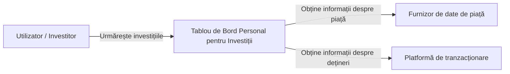

# LABORATOR 1 — DEFINIREA PRODUSULUI INIȚIAL

## Tablou de Bord Personal pentru Investiții

---

## 1. Cercetarea produselor

### Întrebarea de cercetare 
How do existing products help a User follow market information, and which
parts belong in this Dashboard's first version?

Au fost analizate două produse existente:

- **Google Finance** – produs pentru urmărirea informațiilor despre piețe și investiții.
- **Interactive Brokers** – platformă de tranzacționare care permite și urmărirea portofoliului.
### Tabel de cercetare

| Produs | Utilizator probabil și obiectiv | Model reutilizabil |
|---|---|---|
| Google Finance | Investitor individual care dorește să urmărească investițiile și evoluția pieței | Watchlist, informații despre investiții, evoluția prețului și portofoliu |
| Interactive Brokers | Investitor care dorește să urmărească pozițiile și performanța portofoliului | Vizualizarea pozițiilor, valorii portofoliului și performanței |
---

# 2. Părțile interesate și actori

O parte interesată este o persoană sau o organizație care este afectată de produs sau poate influența o decizie privind produsul.

Un actor este o persoană sau un sistem extern care interacționează direct cu Tabloul de Bord.

## 2.1 Identificarea părților interesate

| Parte interesată | Motivație | Influență | Motiv |
|---|---|---|---|
| Utilizator / Investitor | Ridicată | Ridicată | Folosește direct tabloul de bord pentru a urmări investițiile și informațiile despre piață. |
| Furnizor de date de piață | Ridicată | Ridicată | Furnizează informațiile necesare despre prețuri și evoluția instrumentelor financiare. |
|  | Ridicată | Ridicată | Stabilește funcționalitățile și direcția de dezvoltare a produsului. |
| Platformă de tranzacționare | Scăzută | Ridicată | Poate furniza informații despre deținerile și investițiile utilizatorului. |
| Autorități / organisme de reglementare | Scăzută | Ridicată | Pot influența regulile privind utilizarea și prezentarea informațiilor financiare. |
| Alte persoane interesate de investiții | Scăzută | Scăzută | Pot fi interesate de un astfel de produs, dar nu influențează direct dezvoltarea lui. |

## 2.2 Matricea Motivație – Influență

| Motivație / Influență | Influență scăzută | Influență ridicată |
|---|---|---|
| **Ridicată** | — | Utilizator / Investitor; Furnizor de date de piață; Furnizorul produsului |
| **Scăzută** | Alte persoane interesate de investiții | Platformă de tranzacționare; Autorități / organisme de reglementare |

## 2.3 Clasificarea participanților

| Participant | Clasificare | Interacționează direct cu sistemul? |
|---|---|---|
| Utilizator / Investitor | Actor uman direct | Da |
| Furnizor de date de piață | Sistem extern | Da |
| Platformă de tranzacționare | Sistem extern | Da |
| Furnizorul produsului | Parte interesată | Nu |
| Autorități / organisme de reglementare | Parte interesată | Nu |
| Alte persoane interesate de investiții | Parte interesată | Nu |

---

# 3. Promisiunea produsului și domeniul de aplicare

## 3.1 Promisiunea produsului

**Tabloul de Bord Personal pentru Investiții ajută investitorii individuali să urmărească investițiile și informațiile importante despre piață, astfel încât aceștia să poată înțelege mai ușor evoluția propriului portofoliu.**

## 3.2 Obiective

### Obiectiv 1

Utilizatorul poate vedea valoarea actuală a investițiilor sale, astfel încât să înțeleagă situația curentă a portofoliului.

### Obiectiv 2

Utilizatorul poate urmări evoluția investițiilor în timp, astfel încât să observe modificările valorii acestora.

### Obiectiv 3

Utilizatorul poate identifica modificările importante ale investițiilor, astfel încât să știe când informațiile urmărite s-au schimbat.

### Obiectiv 4

Utilizatorul poate păstra o listă a investițiilor pe care dorește să le urmărească, astfel încât să aibă într-un singur loc informațiile relevante.

### Obiectiv 5

Utilizatorul poate vedea informațiile de piață asociate investițiilor sale, astfel încât să poată înțelege mai ușor evoluția acestora.

## 3.3 Non-obiective

### Non-obiectiv 1

Prima versiune nu va permite realizarea directă a tranzacțiilor de cumpărare sau vânzare.

### Non-obiectiv 2

Prima versiune nu va oferi recomandări automate privind cumpărarea sau vânzarea investițiilor.

### Non-obiectiv 3

Prima versiune nu va include funcții complexe de analiză financiară sau planificare avansată a investițiilor.
# 4. Cerințe funcționale

## DASH-1 — Vizualizarea investițiilor

### Scopul actorului

Utilizatorul dorește să vadă investițiile pe care le urmărește și informațiile principale despre acestea.

### User story

**As a User, I want to see my tracked investments, so that I can understand what investments I currently follow.**

### Definitions of done

- Sunt afișate investițiile urmărite și informațiile disponibile despre acestea.
- Utilizatorul poate identifica valoarea disponibilă pentru fiecare investiție.
- Dacă informația despre o investiție lipsește, aceasta este indicată ca indisponibilă.
- Utilizatorul vede doar investițiile pe care le urmărește.

## DASH-2 — Urmărirea evoluției investițiilor

### Scopul actorului

Utilizatorul dorește să afle cum s-a modificat valoarea investițiilor sale în timp.

### User story

**As a User, I want to follow the change in my investments, so that I can understand their evolution over time.**

### Definitions of done

- Utilizatorul poate vedea evoluția valorii unei investiții.
- Utilizatorul poate identifica dacă valoarea investiției a crescut sau a scăzut.
- Dacă datele istorice lipsesc, utilizatorul este informat că evoluția nu poate fi afișată complet.
- Evoluția este prezentată doar pentru perioada pentru care există date.

## DASH-3 — Consultarea informațiilor actuale

### Scopul actorului

Utilizatorul dorește să consulte cele mai recente informații disponibile despre investițiile urmărite.

### User story

**As a User, I want to see current market information, so that I can understand the latest available value of my investments.**

### Definitions of done

- Este afișată cea mai recentă informație disponibilă despre investiție.
- Utilizatorul poate identifica momentul la care informația a fost actualizată.
- Dacă informația este învechită, utilizatorul este informat despre acest lucru.
- Dacă informația nu este disponibilă, aceasta este indicată ca indisponibilă.

## DASH-4 — Adăugarea unei investiții

### Scopul actorului

Utilizatorul dorește să adauge o investiție pe care dorește să o urmărească.

### User story

**As a User, I want to add an investment to my tracked list, so that I can follow its market information.**

### Definitions of done

- Utilizatorul poate identifica investiția pe care dorește să o urmărească.
- Investiția este adăugată în lista investițiilor urmărite.
- Dacă investiția nu este recunoscută, utilizatorul primește un mesaj corespunzător.
- Investițiile pentru care nu există informații acceptate nu sunt adăugate.

## DASH-5 — Identificarea informațiilor indisponibile

### Scopul actorului

Utilizatorul dorește să știe când informațiile despre o investiție lipsesc, sunt învechite sau nu pot fi utilizate.

### User story

**As a User, I want to know when investment information is missing or outdated, so that I do not mistake unavailable information for current information.**

### Definitions of done

- Informațiile lipsă sunt marcate ca indisponibile.
- Informațiile învechite sunt indicate utilizatorului.
- Informațiile neacceptate nu sunt prezentate ca informații valide.
- Utilizatorul poate diferenția informațiile disponibile de cele indisponibile.
# 5. Contextul sistemului C4V

